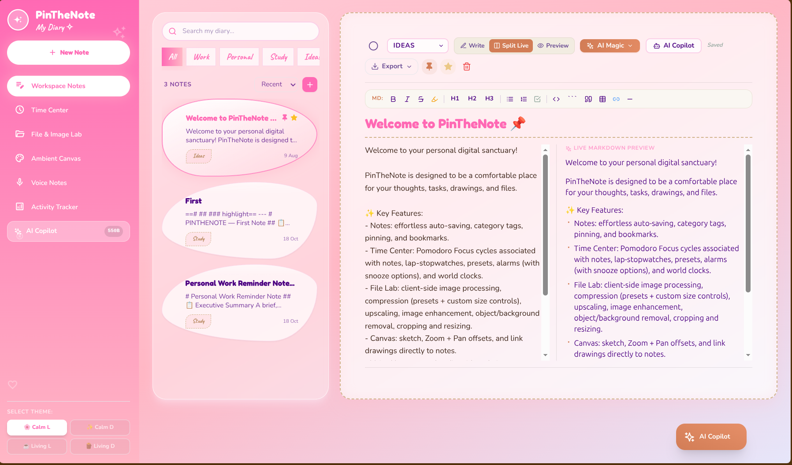
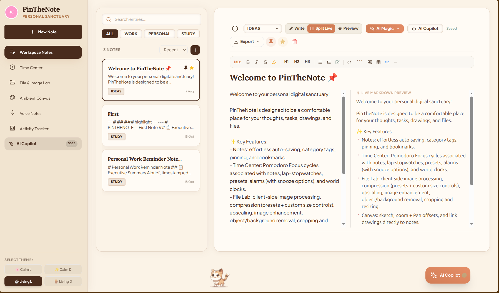
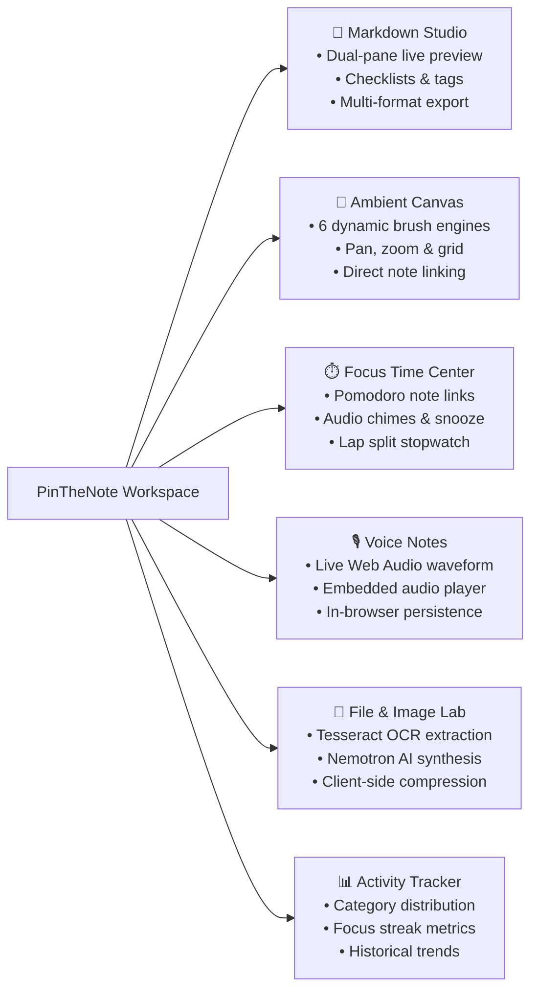
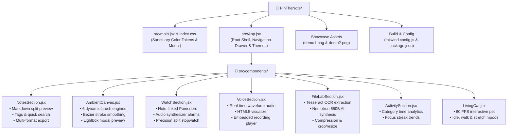

# PinTheNote - The Art of Thinking, Creating & Living Digitally

**A Beautifully Intelligent Workspace for the Modern Mind.**

An elegant, privacy-conscious digital sanctuary where notes, knowledge, creativity, time, and intelligent tools coexist in perfect harmony.

**Thoughtfully Designed. Intelligently Connected. Beautifully Personal.**

<div align="center">

  <p align="center">
    <a href="https://react.dev/"></a>
    <a href="https://vitejs.dev/"></a>
    <a href="https://tailwindcss.com/"></a>
    
    
    
  </p>

</div>

---

## Demo Gallery

<table>
  <tr>
    <td width="50%" align="center">
      <strong>🌸 Calm Blush Sanctuary Mode (Split Markdown & Live Notes)</strong>
      <br/><br/>
      
      <br/>
      <em>Clean blush palette, split live preview editor, tag filter pills, and AI Magic launcher.</em>
    </td>
    <td width="50%" align="center">
      <strong>☕ Living Cozy Sanctuary Mode (Interactive Living Pet Companion)</strong>
      <br/><br/>
      
      <br/>
      <em>Earthy terracotta tones, focus dashboard, and our 60 FPS interactive living companion.</em>
    </td>
  </tr>
</table>

---

## Why PinTheNote?

Traditional note applications are either cold spreadsheets, rigid cloud subscriptions with privacy concerns, or fragmented across five different apps. **PinTheNote** brings harmony back to your workflow:

- **100% Local-First & Sovereign**: Everything stays on your machine. Notes, drawings, and voice audio blobs persist securely in `localStorage` and `IndexedDB`. Zero mandatory accounts, zero cloud tracking, instant boot.
-  **Adaptive Sanctuary Themes**: Switch seamlessly between **🌸 Calm Light** (Blush Diary), **✨ Calm Dark** (Midnight Velvet), **☕ Living Light** (Warm Espresso & Clay), and **Living Dark** (Nordic Slate).
- **The Living Companion**: A delightful 60 FPS animated feline companion strolls, stretches, and rests along your workspace footer, responding to your work rhythms.
- **True Responsive Design**: Fluidly adapts across desktops, ultrabooks, tablets, and smartphones with an intuitive mobile navigation drawer and touch-optimized gestures.

---

## Key Modules & Capabilities



### 1.  Smart Markdown Notes Studio
- **Dual-Pane Live Preview**: Write GitHub-flavored Markdown on the left while enjoying rendered HTML, styled typography, and interactive checklists on the right.
- **Categorization & Tags**: Organize thoughts with customizable color tags, search in real-time, and pin high-priority notes to the top.
- **Universal Export**: One-click export to `.md`, `.txt`, `.html`, `.json`, `.png` (snapshot), and clean printable `.pdf`.
- **Media Attachments**: Link drawings created in the Ambient Canvas or voice memos recorded in the Audio Studio directly to any note.

### 2.  Ambient Canvas Studio
- **6 Precision Brush Engines**:
  - ✏️ **Smooth Pen**: Ultra-responsive fluid ink line.
  - 🖊️ **Pencil**: Textured graphite simulation with subtle grain.
  - ✒️ **Calligraphy**: Dynamic angled chisel strokes.
  - 🖍️ **Neon Marker / Highlighter**: Translucent vibrant accentuation.
  - 💨 **Airbrush / Spray Paint**: Radial particle dispersion for sketching and shading.
  - 💫 **Soft Glow**: Neon luminescence for creative highlights.
- **Canvas Navigation**: Infinite pan (`Space` + drag), smooth zoom controls, and an instant background grid toggle.
- **Undo / Redo History**: Comprehensive step history with keyboard shortcuts (`Ctrl+Z`, `Ctrl+Y`).
- **Drawing Gallery & Lightbox**: Inspect saved sketches in full-screen zoomable lightbox previews and link them into notes.

### 3.  Focus Time Center
- **Pomodoro Focus Engine**: Customizable work/break cycles directly attached to your active note tasks.
- **Gentle Audio Chimes**: Web Audio synthesizer chime with customizable snooze and alarm volume.
- **Precision Stopwatch**: Millisecond-accurate chronograph with split lap logs and export capabilities.

### 4.  Voice Notes Studio
- **Real-Time Waveform Visualizer**: Live audio frequency bars rendered via the HTML5 Canvas & Web Audio API during recording.
- **Embedded Audio Player**: Scrub, play, pause, and preview voice recordings directly inside notes.
- **Blob Persistence**: Stored efficiently in client-side `IndexedDB` with zero external uploads.

### 5.  File & Image Lab
- **Client-Side OCR**: Extract clean editable text from uploaded images, documents, or screenshots via `tesseract.js`.
- **AI Note Synthesis**: Transform raw OCR dumps or brainstorming bullets into beautifully structured markdown summaries with **NVIDIA Nemotron 550B** (via OpenRouter API).
- **Image Tooling**: In-browser client-side image compression, aspect crop, resize, and background cutout.

### 6.  Activity & Focus Analytics
- Visual breakdown of time invested per category and tag.
- Pomodoro completion streaks and productivity trends.

---

##  Productivity Shortcuts

| Action | Shortcut |
| :--- | :--- |
| **Pan Canvas** | `Space` or `Shift` + Click & Drag |
| **Undo Stroke** | `Ctrl + Z` / `Cmd + Z` |
| **Redo Stroke** | `Ctrl + Y` / `Cmd + Shift + Z` |
| **Clear Canvas** | Click `Clear` in toolbar |
| **Toggle Split Preview** | Split button in Markdown toolbar |
| **Export Note** | Export menu in Note Editor |

---

##  Architecture & Tech Stack

| Layer | Technologies |
| :--- | :--- |
| **Core Framework** | [React 18.2](https://react.dev/) + [Vite 5](https://vitejs.dev/) |
| **Styling & System** | [Tailwind CSS 3.4](https://tailwindcss.com/) + Custom CSS Sanctuary Tokens |
| **Icons & Visuals** | [Lucide React](https://lucide.dev/) |
| **Storage Engine** | Browser `localStorage` + `IndexedDB` (Local-First Architecture) |
| **Vision & OCR** | [Tesseract.js v7](https://tesseract.projectnaptha.com/) |
| **AI Intelligence** | NVIDIA Nemotron 550B / OpenRouter API |
| **Canvas & Audio** | HTML5 Canvas 2D Context + Web Audio API + MediaStream Recording |
| **Export Engines** | [html2canvas](https://html2canvas.hertzen.com/) + Native Print Engine |

---

##  Quick Start

### Prerequisites
- [Node.js](https://nodejs.org/) (v18 or higher recommended)
- `npm` or `pnpm` or `yarn`

### 1. Clone the Repository
```bash
git clone https://github.com/SonaliDuvesh/PinTheNote.git
cd PinTheNote
```

### 2. Install Dependencies
```bash
npm install
```

### 3. Start Development Server
```bash
npm run dev
```
Open your browser at `http://localhost:3000` (or the port output in your terminal).

### 4. Build for Production
```bash
npm run build
npm run preview
```

---

##  Optional AI Configuration

PinTheNote is fully functional offline without any API keys. If you wish to use the **AI Magic Synthesizer** (NVIDIA Nemotron 550B) in the File Lab, simply supply an OpenRouter API key inside the app settings modal or define it in your environment:

```env
VITE_OPENROUTER_API_KEY="your-openrouter-key-here"
```

---

##  Project Structure



---

## 📄 License

Copyright (c) 2026 [Sonali Duvesh](https://github.com/SonaliDuvesh). All rights reserved.

No permission is granted to use, copy, modify, distribute, or
commercially exploit this source code or its associated assets
without prior written permission from the copyright holder.

Access to the deployed application is permitted for personal use
subject to its applicable Terms of Use. This does not grant any
license to reuse, reproduce, or redistribute the website's code,
design, branding, or assets.

THE SOFTWARE IS PROVIDED "AS IS", WITHOUT WARRANTY OF ANY KIND.

---

<div align="center">
  <sub>Crafted with passion for calm, thoughtful, and expressive productivity. 🌿</sub>
</div>
